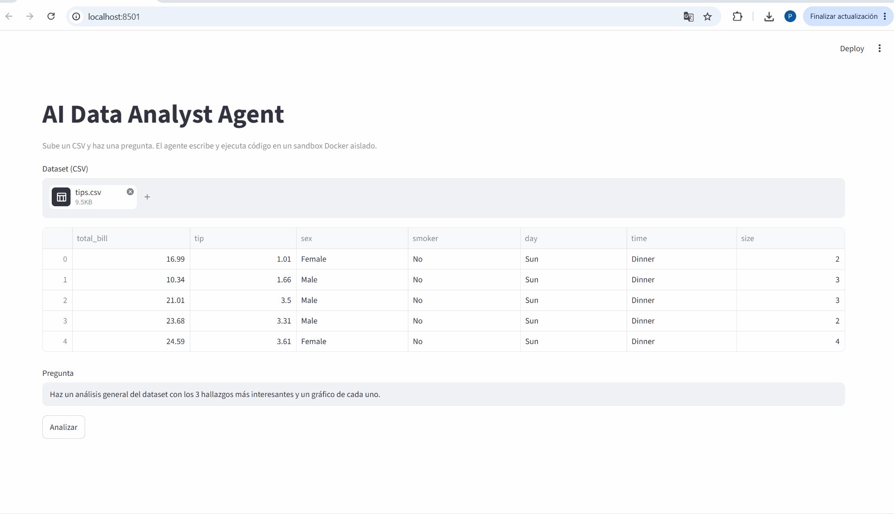
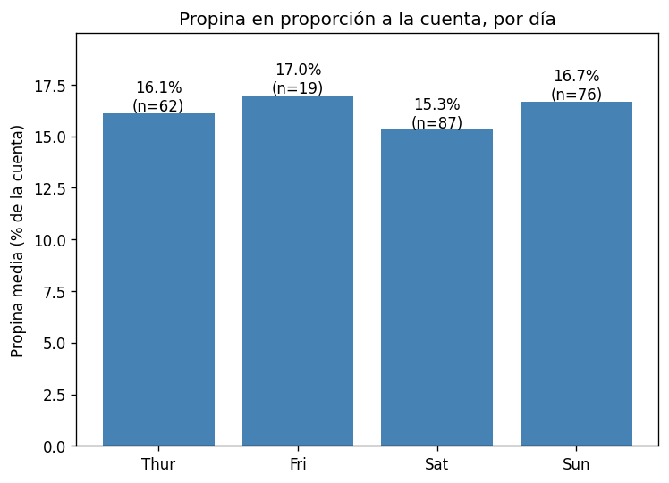

# AI Data Analyst Agent


Agente que responde preguntas sobre un dataset escribiendo y ejecutando su propio código Python. El código se ejecuta en un contenedor Docker aislado, así que nunca toca la máquina anfitriona.



## Cómo funciona

1. El usuario pasa un CSV y una pregunta.
2. El modelo (Claude) decide qué análisis hacer y escribe código.
3. El código se ejecuta en el sandbox y la salida vuelve al modelo.
4. Si hay un error, el agente lo lee y corrige el código.
5. Cuando tiene la respuesta, devuelve las conclusiones y los gráficos generados.

## Sandbox

El código lo genera un LLM, así que se trata como no confiable. Cada ejecución corre en un contenedor nuevo que se destruye al terminar:

| Riesgo | Protección |
|---|---|
| Exfiltrar datos o descargar malware | Sin acceso a red |
| Modificar el dataset original | `/data` montado en solo lectura |
| Escribir en el sistema | Sistema de archivos de solo lectura; solo `/output` y `/tmp` son escribibles |
| Escalada de privilegios | Usuario sin privilegios (uid 1000), `cap_drop=ALL`, `no-new-privileges` |
| Agotar recursos (bucles, fork bombs) | 512 MB de RAM, 1 CPU, máximo 64 procesos, timeout de 60 s |

`test_sandbox.py` intenta cada uno de estos ataques y comprueba que fallan:

```
--- Acceso a internet ---
urllib.error.URLError: <urlopen error [Errno -3] Temporary failure in name resolution>
--- Modificar los datos ---
OSError: [Errno 30] Read-only file system: '/data/hack.txt'
--- Escribir en el sistema ---
OSError: [Errno 30] Read-only file system: '/etc/hack.txt'
--- Usuario (0 = root) ---
1000
```

## Ejemplo

```
python agent.py data/tips.csv "¿Qué día se dejan más propinas en proporción a la cuenta? Haz un gráfico."
```

El agente explora primero las columnas, calcula la propina en porcentaje por día y genera el gráfico. Además avisa de que el viernes tiene pocas muestras y de que no ha hecho contraste estadístico.



## Instalación

Requisitos: Python 3.10+, Docker y una API key de Anthropic.

```
git clone https://github.com/pablofranco1/ai-data-analyst-agent.git
cd ai-data-analyst-agent
python -m venv venv
venv\Scripts\activate
pip install -r requirements.txt
docker build -t agent-sandbox .
```

Crea un archivo `.env` con:

```
ANTHROPIC_API_KEY=tu_api_key
```

## Uso

Interfaz web:

```
streamlit run app.py
```

Desde terminal:

```
python agent.py data/tips.csv "tu pregunta"
```

## Estructura

- `app.py`: interfaz web con Streamlit
- `agent.py`: bucle del agente y uso de herramientas
- `sandbox.py`: ejecución aislada en Docker
- `test_sandbox.py`: pruebas de seguridad del sandbox
- `Dockerfile`: imagen del sandbox
- `data/`: datasets de ejemplo